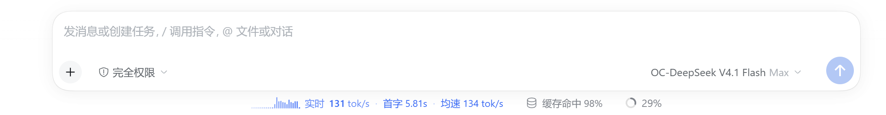

# dsh-flowmeter · 模型流速

[](https://www.npmjs.com/package/dsh-flowmeter)
[](LICENSE)


给 [DeepSeek Harness](https://github.com/deepseek-ai/deepseek-harness) 输入框下方加一枚读数：**实时输出速度 · 速度图表 · 首字延迟 · 本步均速**；左侧栏底部再加一枚全库读数：**所有会话的合计/平均流速 + 图表**。

> A TPS/TTFT readout for the DeepSeek Harness composer footer — live tokens-per-second, a speed chart, time-to-first-token, and the per-step average decode speed — plus an all-sessions total/average meter in the sidebar foot. Pure JavaScript, no build step, no runtime dependencies.



*柱状图模式，右边依次是官方的「缓存命中」与上下文占用。同一份数据也可以在设置里画成曲线。*

```
▁▂▄▆▇▅▃▂  实时 131 tok/s  ·  首字 5.81s  ·  均速 134 tok/s
```

它接管的是官方那枚「输出速度」统计格（`activity`，同 id + 更低 `priority`），所以读数排在整行最前面，官方那枚**整步平均速度不再重复显示**；「缓存命中」与上下文占用两枚保持原样。

## 读数

| 项 | 含义 |
|---|---|
| 实时 | 最近 1.2 秒滑动窗口的 tok/s，来自真实的 `agent/assistant-stream` 分片，不是整步平均 |
| 图表 | 每桶 400ms、共 24 桶（约 9.6 秒）；柱状图或曲线图，同一份数据两种画法 |
| 首字 | 本步 `step/start` → 第一个 token 的墙钟（TTFT）；还没出字时显示已等待秒数并带省略号 |
| 均速 | 本步解码速度 = 累计 token ÷ 首字后时长，口径同 [dsh-tps-ttft](https://github.com/oldzhang82/dsh-tps-ttft) 的 `decodeTokens / (decodeMs / 1000)` |

三种状态：

| 状态 | 一行读数 |
|---|---|
| 等首字 | `0 tok/s ▁▂▄ · 首字 1.20s… · 均速 172 tok/s` |
| 生成中 | `▁▂▄▆▇▅▃▂ 实时 154.6 tok/s · 首字 3.78s · 均速 103.9 tok/s` |
| 一轮结束 | `0 tok/s ▁▂▄ · 首字 3.78s · 均速 172 tok/s`（整枚变淡） |

> 生成期间实时值会跳、均速是收敛的累计值，两个数可以对比着看"这一拍快不快、整体快不快"。空闲时实时归 0，均速保留最近一步 —— 只要跑过一步就一直挂着。

## 侧栏合计读数

左侧栏底部、Settings 上方多一张小卡：**两行** —— 第一行是读数与「累加 / 平均」切换，第二行是带简单 Y 轴的整宽平滑曲线。卡片样式对齐同一区域里其他额度卡（圆角、细边框、底色），并用更小的 `order` 排在它们上面一行。

```
● 合计 286 tok/s                    [累加|平均]
300 ┤        ╭─╮
150 ┤  ╭─────╯ ╰──╮
  0 ┴──╯          ╰
```

侧栏这一枚用的是自己的 id，属于**新增**控件，不接管任何官方格子。

| 口径 | 读数 | 含义 |
|---|---|---|
| 累加 | 所有正在解码的会话实时速度之和 | 这台机器此刻的总吞吐 |
| 平均 | 合计 ÷ 正在出字的会话数 | 平均每个会话跑多快 |

- 第一行左侧的圆点在出字时点亮、空闲时变暗，标签跟着口径走（合计 / 平均）；整张卡空闲时也会变淡。
- 图表跟着口径走：累加是每桶所有会话 token 相加；平均再除以**该桶里真有 token 的会话数**，所以某个会话停下来时平均线不会因为分母变小而突然跳高。
- 侧栏这张图固定为平滑曲线，左侧三档 Y 轴刻度（顶、中、0）配三条浅网格线；刻度上限按一位有效数字取整（286 → 300），曲线不会缩在底部。
- 输入框那枚仍按设置里的「图表」画柱状图或折线图，两处用的是同一组 400ms 分桶。
- 只有「等首字 / 出字」的会话参与计算；等首字但还没吐字的会话不进平均值的分母。
- 侧栏折叠成 56px 窄栏时放不下卡片，只留一个圆形数字，点一下也能切换口径；Windows 标题栏模式下侧栏折叠时 DSH 会隐藏整块底部区域，此时看不到这枚读数。
- 口径存在本地（`dsh-flowmeter:settings`），和配色/图表画法共用一个设置 store，改完立即生效。

## 安装

前置：DeepSeek Harness `0.2.2-rc.1` 及以上（桌面版或 `dsh web` 均可）。纯 JS、无构建、无运行时依赖，装完即用。

### 方式一：按包名安装（最简单）

```sh
dsh plugin --profile <profile> add dsh-flowmeter
```

或者完全不碰命令行：侧栏「插件」→「添加插件」→ 输入 `dsh-flowmeter` → 安装。

### 方式二：从 GitHub 安装（可锁 commit）

```sh
dsh plugin --profile <profile> add "github:PilotPhil/dsh-flowmeter#<commit-sha>"
```

> `--profile` 填你的 profile 名（桌面版通常是 `desktop`）。PowerShell 里 `#` 是注释符，**参数要带引号**，否则 SHA 会被吞掉。
>
> 锁完整 commit SHA 而不是分支名：以后上游推送不会悄悄改掉你装的东西。

### 方式三：本地目录安装

```sh
dsh plugin --profile <profile> add "C:\path\to\dsh-flowmeter"
```

pnpm 会建一个 `link:` 依赖，源码改了立刻生效，适合自己改着玩。也可以直接在「插件」页用「添加」选中这个目录。

### 装完要做的

重启 DSH。三种方式都会把包装进 profile，并**自动**把 `dsh-flowmeter` 写进该 profile `package.json` 的 `dsh.profile.bundles`（以 npm 安装为例）：

```json
{
  "dependencies": { "dsh-flowmeter": "^1.1.0" },
  "dsh": { "profile": { "bundles": ["@deepseek-ai/dsh-base", "dsh-flowmeter"] } }
}
```

如果「插件」页里已经能看到 **模型流速**、但输入框下方没有读数，按一次 F5 刷新页面（客户端模块要重新加载）。

### 验证装好了

- 输入框下方那一行，最左边出现 `▁▂▄▆▇▅▃▂ 实时 … tok/s`；
- 左侧栏底部（Settings 上方）出现一张两行小卡：`● 合计 0 tok/s [累加|平均]` + 一条贴底的平滑曲线（左侧 0 刻度）；
- 「插件」页里本插件那一页能看到三行设置（配色 / 图表 / 侧栏口径）；
- 随便发一轮对话，两处数字应该开始跳；开两轮对话，侧栏「累加」应约等于两个读数相加。

### 卸载

「插件」页里卸载（或 `dsh plugin --profile <profile> remove dsh-flowmeter`）。插件只读观测：不注册会话投影、不写会话日志、不改模型请求，卸载后不残留。

## 设置

「插件」页 → **模型流速** → 进入它那一页，描述下方就是设置面板：

| 项 | 可选值 | 说明 |
|---|---|---|
| 配色 | 默认 / 蓝 / 青 / 紫 / 橙 / 绿 / 灰 / 自定义 | 数字、标签、图表、分隔符统一一种颜色；「默认」跟随主题品牌色，自定义走系统取色器 |
| 图表 | 柱状图 / 曲线图 | 输入框那枚的画法：同一组 400ms 分桶与同一套归一化，只换画法；侧栏合计卡固定为平滑曲线 |
| 侧栏口径 | 累加 / 平均 | 侧栏底部那枚全库读数的统计方式，与读数上的切换是同一个设置 |

改完**立即生效**，不需要重启：读数、侧栏读数与设置面板订阅同一个内存 store。偏好存在浏览器 `localStorage`（键 `dsh-flowmeter:settings`），因此**换浏览器/换机器不同步** —— 这是纯显示偏好，没有写进 profile。

## 它是怎么工作的

不改 DSH 核心，两半都在本包里：

```
agent/assistant-stream ─┐
                        ├─→ 每会话有界窗口 ─┬→ GET /dsh-flowmeter/state.json ───→ 输入框读数
session/event ──────────┘        (Host)      └→ GET /dsh-flowmeter/summary.json ─→ 侧栏合计读数
                                                (Client 轮询)
```

- **Host**（[`index.js`](index.js)）：订阅 `agent/assistant-stream`（实时分片，带高精度时间戳）与 `session/event`（`step/start` / `assistant/message` / `tool/call` / `turn/end`），为每个会话维护**有界**的滑动窗口 + 400ms 环形分桶，并通过 `ctx.webServer` 注册两个只读端点：单会话读数，以及把所有会话按同一套分桶合成的合计/平均读数。
- **Client**（[`client.js`](client.js)）：在 `conversation.composer.dock` 注册输入框读数、在 `sidebar.footer.action` 注册侧栏读数，两个组件各自轮询对应端点。相位自适应：等首字/出字时 500ms 一次，其余 2.5s 一次；页面不可见时退到慢速；请求失败保留上一帧，不闪。

为什么用轮询而不是推送：Client 半是普通 slot 组件，拿不到 Host 的进程内事件；端点同源、单次响应 < 2KB，代价可以忽略。

### 收尾式串流

有些 provider 把整段回复一次性送达，没有可观察的解码窗口 —— 此时 `首字 → assistant/message` 只有几毫秒，直接算会得到爆表的速度。这种情况退回「整步墙钟」计速，并在悬停提示里标注「整步计速」，读数仍然可测，但不假装知道真实解码速度。

### 精度说明

流式期间提供方还没上报 `usage`，token 数只能估算（ASCII ÷ 4 + CJK × 0.6）；每步落盘后立刻换成**精确**的 `outputTokens`。所以实时值是估算口径、均速在结束时收敛为精确值 —— 这是这类插件无法绕开的限制。

## 兼容性

- 在 DSH `0.2.2-rc.1`（Windows 桌面版）上开发与验证。
- 依赖的宿主接口：`agent/assistant-stream` 事件、`session/event` 事件、`ctx.webServer.register`、以及 `conversation.composer.dock` / `plugins.bundle.config` / `sidebar.footer.action` 三个槽位。侧栏槽位由 `@deepseek-ai/dsh-client-ui-sidebar` 声明，已在包清单的 `dsh.client.inject` 里声明为激活依赖。
- 接管的是 `activity` 这一格。**副作用**：详细模式（`ui-chat.performanceUsage: detailed`）下，原格子里的「轮次/步骤计数 + 模型耗时/工具耗时/首字」浮层会一并被替换；简洁模式本来就只看速度，没有损失。

## 目录

```
dsh-flowmeter/
├── index.js            # Host 半：串流追踪 + 只读端点
├── client.js           # Client 半：读数、图表、设置面板
├── cordis.patch.yml    # loader 插入行
├── package.json        # 包清单（dsh.bundle.patch、dsh.client）
├── icon.svg            # 插件页封面
├── locale/{zh,en}.json # 插件页标题与描述
├── docs/screenshot.png # 效果图
├── LICENSE
└── README.md
```

## License

MIT
